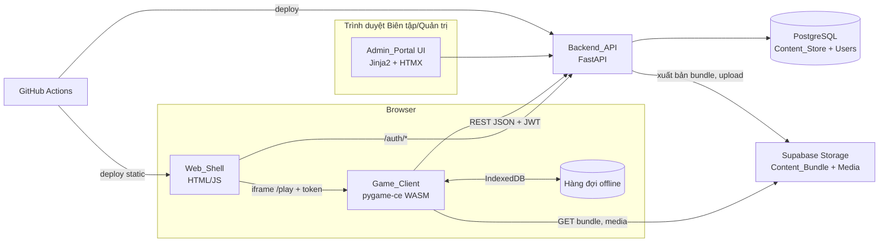
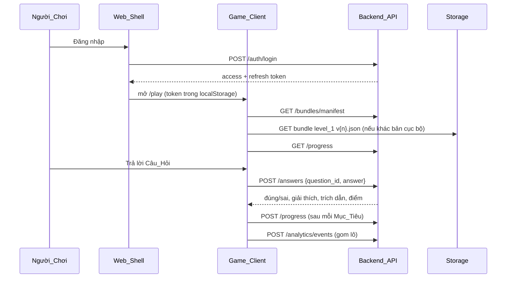
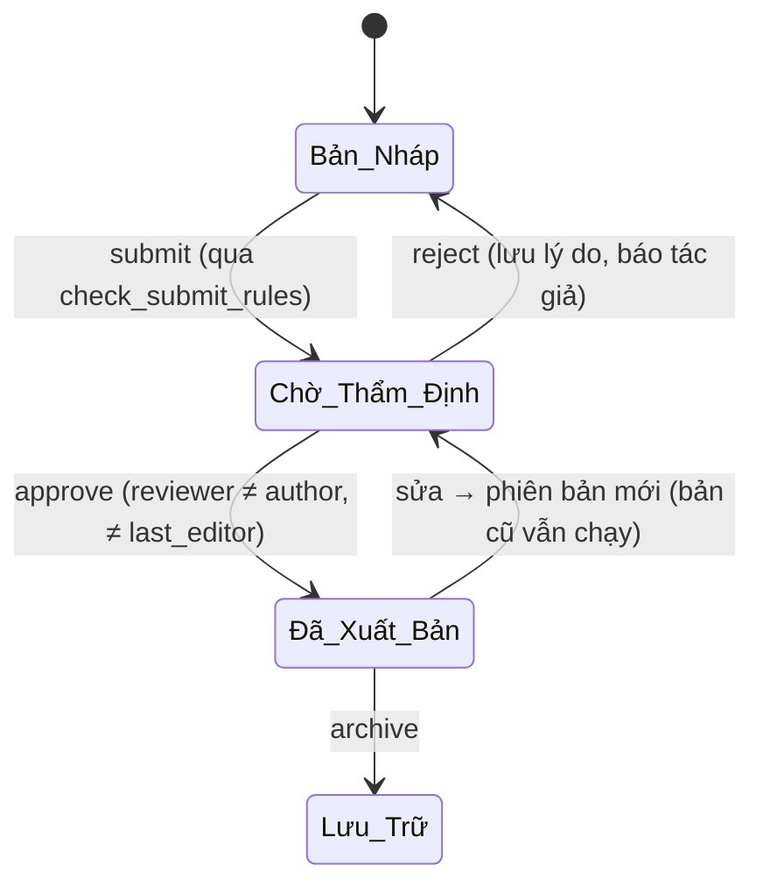
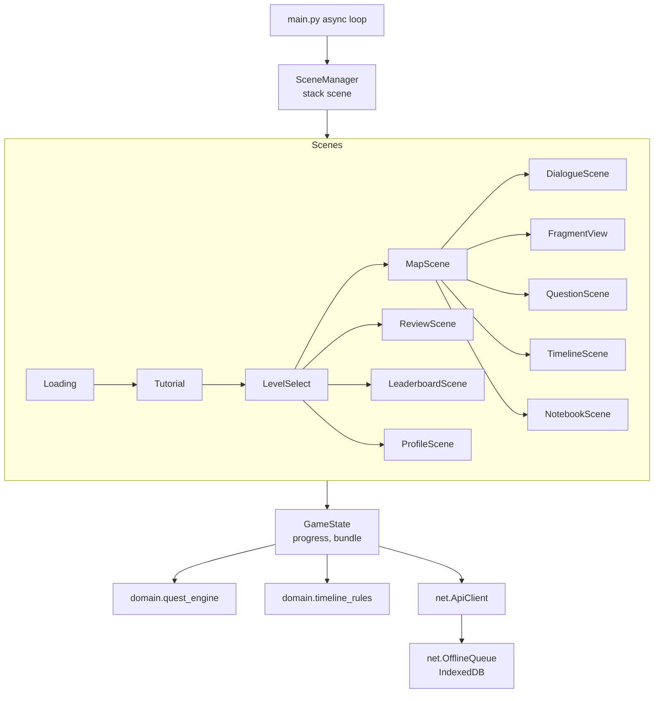
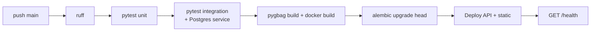

# Design Document — Sử Ký Điều Tra

## Overview

Hệ thống gồm 4 khối triển khai độc lập:

1. **Web_Shell** (HTML/JS tĩnh): trang giới thiệu, đăng ký, đăng nhập, chính sách, "Nguồn và ghi công", "Phương pháp biên soạn". Nhúng Game_Client vào trang `/play`.
2. **Game_Client** (Python + pygame-ce, đóng gói bằng pygbag thành WebAssembly): toàn bộ lối chơi Bản*Đồ, Nhiệm_Vụ, Dòng_Thời_Gian, Sổ_Tay*Điều_Tra, ôn tập.
3. **Backend_API** (FastAPI): xác thực, phân quyền, nội dung, chấm điểm, tiến trình, bảng xếp hạng, phân tích. Phục vụ luôn **Admin_Portal** (Jinja2 + HTMX) trong cùng tiến trình.
4. **Dữ liệu**: PostgreSQL (Supabase) cho Content_Store và dữ liệu người dùng; Supabase Storage cho Media_Store và Content_Bundle.

### Kết quả nghiên cứu ảnh hưởng thiết kế

| Vấn đề                         | Phát hiện                                                                                             | Quyết định                                                                                                                                                                  |
| ------------------------------ | ----------------------------------------------------------------------------------------------------- | --------------------------------------------------------------------------------------------------------------------------------------------------------------------------- |
| Pygame vs Arcade trên web      | pygbag chỉ hỗ trợ pygame-ce (Arcade cần pyglet/OpenGL desktop) — https://pygame-web.github.io         | Dùng **pygame-ce 2.5.x** + **pygbag 0.9.x**                                                                                                                                 |
| Vòng lặp game trên trình duyệt | pygbag yêu cầu `async def main()` và `await asyncio.sleep(0)` mỗi khung hình                          | Kiến trúc Scene chạy trong một vòng lặp async duy nhất                                                                                                                      |
| Gọi HTTP trong WASM            | Không có `requests`/socket; dùng `platform.window.fetch` (JS interop)                                 | Viết lớp `ApiClient` bọc JS fetch, có bản thay thế `httpx` khi chạy desktop để test                                                                                         |
| Nhập văn bản                   | Bàn phím ảo trên mobile không mở được ổn định từ canvas                                               | Đăng nhập/đăng ký ở Web_Shell (HTML form); token truyền vào game qua `localStorage`                                                                                         |
| Phông chữ tiếng Việt           | Phông mặc định của pygame thiếu dấu; cần TTF nhúng                                                    | Nhúng **Be Vietnam Pro** hoặc **Noto Sans** (giấy phép SIL OFL), chuẩn hóa chuỗi NFC trước khi render                                                                       |
| Lưu cục bộ                     | WASM có thể truy cập `localStorage`/IndexedDB qua `platform.window`                                   | Hàng đợi tiến trình offline lưu trong IndexedDB (Req 19.3)                                                                                                                  |
| Bản đồ nền                     | GADM giới hạn tái phân phối; nhiều bộ dữ liệu quốc tế thể hiện Hoàng Sa, Trường Sa không đúng         | Tự vẽ bản đồ nền minh họa dựa trên _Atlat Địa lí Việt Nam_ và dữ liệu của Cục Đo đạc, Bản đồ và Thông tin địa lý Việt Nam; bắt buộc thể hiện Hoàng Sa, Trường Sa (Req 10.2) |
| Quy đổi âm lịch                | Thuật toán Hồ Ngọc Đức chỉ chính xác cho lịch hiện đại; lịch thời trung đại khác nhau theo từng triều | Không tự động quy đổi ngày trước 1900; Biên_Tập_Viên nhập ngày dương lịch kèm Trích_Dẫn phương pháp quy đổi (Req 3.4)                                                       |
| Admin UI                       | Cần nhiều biểu mẫu CRUD, ưu tiên giữ một ngôn ngữ                                                     | Jinja2 + HTMX render phía máy chủ, không cần build JS                                                                                                                       |

### Ngăn xếp công nghệ (phiên bản cố định)

| Lớp               | Công nghệ                                                                                         |
| ----------------- | ------------------------------------------------------------------------------------------------- |
| Game              | Python 3.12, pygame-ce 2.5.8, pygbag 0.9.3                                                        |
| Backend           | FastAPI 0.162.x, Uvicorn, SQLAlchemy 2.0 (async, asyncpg), Alembic, Pydantic v2                   |
| Auth              | PyJWT, pwdlib[argon2], Authlib (Google OAuth 2.0)                                                 |
| Giới hạn tần suất | slowapi                                                                                           |
| Admin             | Jinja2, HTMX, Leaflet (chọn tọa độ, Req 28.2)                                                     |
| DB/Storage        | Supabase PostgreSQL 15+, Supabase Storage                                                         |
| Test              | pytest, pytest-asyncio, httpx, hypothesis (property test cho chấm điểm, ôn tập)                   |
| CI/CD             | GitHub Actions                                                                                    |
| Hosting           | Backend: Render hoặc Fly.io (Docker); Web_Shell + Game_Client: Cloudflare Pages hoặc GitHub Pages |
| Giám sát          | Nhật ký JSON có cấu trúc; Sentry tùy chọn                                                         |

## Architecture



### Luồng chính



### Quyết định kiến trúc

- **Monolith mô-đun cho Backend**: một ứng dụng FastAPI chia router theo miền (auth, content, review, play, leaderboard, analytics, admin). Đủ cho 500 người đồng thời (Req 34.4), dễ triển khai cho nhóm sinh viên.
- **Content_Bundle tĩnh**: nội dung đã xuất bản được đóng gói JSON theo Màn_Chơi, đẩy lên Storage/CDN. Game tải một lần, chơi mượt, giảm tải API. Bundle không chứa đáp án (Req 16.3).
- **Chấm điểm phía máy chủ**: mọi đáp án gửi về API; điểm ghi vào sổ cái bất biến `score_ledger` để chống gian lận và tính bảng xếp hạng theo khoảng thời gian (Req 22).
- **Nội dung có phiên bản**: mỗi thực thể nội dung có bảng `content_versions` lưu ảnh chụp JSON; bản Đã_Xuất_Bản hiện hành được trỏ bằng `published_version_id`, nên sửa bài không ảnh hưởng bản đang chạy (Req 5.5, 6).
- **Tách định danh phân tích**: `analytics_events` dùng `anon_id = HMAC-SHA256(secret, user_id)`, không lưu khóa ngoại tới bảng users (Req 30.5, 25.5).

## Components and Interfaces

### Cấu trúc thư mục

```
webgamelichsuvietnam/
├── backend/
│   ├── app/
│   │   ├── main.py              # tạo app, CORS, router, health
│   │   ├── config.py            # Settings (pydantic-settings, đọc env)
│   │   ├── db.py                # engine, session async
│   │   ├── models/              # SQLAlchemy models (theo miền)
│   │   ├── schemas/             # Pydantic schemas
│   │   ├── auth/                # router, jwt, password, oauth, deps (require_role)
│   │   ├── content/             # CRUD nguồn, sự kiện,... + validators trích dẫn
│   │   ├── review/              # workflow thẩm định, phiên bản, báo cáo sai sót
│   │   ├── publish/             # dựng Content_Bundle
│   │   ├── play/                # tiến trình, chấm điểm, ôn tập, huy hiệu
│   │   ├── leaderboard/
│   │   ├── classroom/
│   │   ├── analytics/
│   │   ├── privacy/             # xuất/xóa dữ liệu
│   │   └── admin_ui/            # Jinja2 templates + routes HTMX
│   ├── alembic/
│   ├── seed/                    # nguồn khởi tạo (Phụ lục A), dữ liệu mẫu
│   └── tests/
├── game/
│   ├── main.py                  # async main loop (yêu cầu của pygbag)
│   ├── core/                    # scene_manager, input, assets, fonts, i18n
│   ├── net/                     # api_client (JS fetch / httpx), offline_queue
│   ├── domain/                  # logic thuần: timeline_rules, quest_engine, unlock
│   ├── scenes/                  # loading, tutorial, level_select, map, dialogue,
│   │                            # question, timeline, notebook, review, leaderboard, profile
│   ├── ui/                      # widget: button, panel, text_wrap, scroll, card, toast
│   ├── assets/                  # fonts, sprites, map tiles
│   └── tests/
├── web/                         # Web_Shell: index, login, register, play, credits, method
└── .github/workflows/
```

Nguyên tắc: `game/domain/` không import pygame, để test bằng pytest trên máy thường và dùng chung luật với backend khi cần.

### Backend_API — Endpoint

Tiền tố `/api/v1`. Quyền: G=Khách, P=Người*Chơi, T=Giáo_Viên, E=Biên_Tập_Viên, R=Người_Thẩm*Định, A=Quản_Trị_Viên.

| Nhóm           | Method & Path                                                                                                                                              | Quyền | Req            |
| -------------- | ---------------------------------------------------------------------------------------------------------------------------------------------------------- | ----- | -------------- | --- | ------ |
| Auth           | `POST /auth/register`                                                                                                                                      | G     | 23.1, 27.1–2   |
|                | `POST /auth/verify-email`                                                                                                                                  | G     | 23.1           |
|                | `POST /auth/login`                                                                                                                                         | G     | 23.3–4         |
|                | `POST /auth/refresh`, `POST /auth/logout`                                                                                                                  | P     | 23.3           |
|                | `GET /auth/google/login`, `GET /auth/google/callback`                                                                                                      | G     | 23.5           |
|                | `POST /auth/password-reset/request`, `/confirm`                                                                                                            | G     | 23.6           |
|                | `POST /auth/guardian-consent/{token}`                                                                                                                      | G     | 27.2           |
| Nguồn          | `GET/POST /sources`, `PATCH /sources/{id}`                                                                                                                 | E     | 1.1–2, 1.5     |
|                | `POST /sources/{id}/approve`                                                                                                                               | R     | 1.3            |
| Nội dung       | `GET/POST/PATCH /content/{type}[/{id}]` (type: events, persons, places, causal-links, fragments, dialogues, questions, quests, levels, badges, map-layers) | E     | 28.1           |
|                | `POST /content/{type}/{id}/citations`                                                                                                                      | E     | 2.1            |
|                | `POST /content/import` (CSV/JSON)                                                                                                                          | E     | 28.5           |
|                | `POST /media` (multipart + license)                                                                                                                        | E     | 8.1–2          |
| Thẩm định      | `POST /content/{type}/{id}/submit`                                                                                                                         | E     | 2.2–5, 4.4     |
|                | `POST /content/{type}/{id}/approve`, `/reject`                                                                                                             | R     | 5.2–4, 3.3     |
|                | `GET /content/{type}/{id}/versions`, `/diff?a=&b=`, `POST /restore/{v}`                                                                                    | R     | 6.1–3          |
|                | `POST /levels/{id}/publish`                                                                                                                                | R     | 29.1–3         |
| Báo lỗi        | `POST /reports`                                                                                                                                            | P     | 7.1–2          |
|                | `GET /reports`, `PATCH /reports/{id}`                                                                                                                      | R     | 7.3–4          |
| Chơi           | `GET /bundles/manifest`                                                                                                                                    | P     | 29.4           |
|                | `GET /progress`, `PUT /progress`                                                                                                                           | P     | 19.1–4         |
|                | `POST /answers`                                                                                                                                            | P     | 16.2, 18, 22.5 |
|                | `POST /timeline/complete`                                                                                                                                  | P     | 18.4           |
|                | `GET /review/{level_id}`, `POST /review/answers`                                                                                                           | P     | 20             |
|                | `GET /me/badges`, `GET /me/notifications`                                                                                                                  | P     | 21.3, 7.4      |
| Xếp hạng       | `GET /leaderboard?period=week                                                                                                                              | month | all&class_id=` | P   | 22.1–2 |
| Lớp học        | `POST /classes`, `POST /classes/join`, `GET /classes/{id}/progress`, `GET /classes/{id}/export.csv`                                                        | T / P | 26             |
| Phân tích      | `POST /analytics/events` (lô ≤ 50)                                                                                                                         | P     | 30.1           |
|                | `GET /analytics/dashboard`, `/funnel/{level_id}`                                                                                                           | A     | 30.2–4         |
| Người dùng     | `GET /users`, `PATCH /users/{id}/role`, `POST /users/{id}/disable`                                                                                         | A     | 25.1–4         |
| Quyền riêng tư | `POST /me/export`, `DELETE /me`                                                                                                                            | P     | 27.4, 25.5     |
| Vận hành       | `GET /health`, `POST /client-errors`                                                                                                                       | G     | 33.5, 34.3     |

### Backend — Mô-đun chính

**auth**

- `password.py`: `hash_password`, `verify_password` dùng pwdlib argon2 (Req 23.2).
- `jwt.py`: access token 15 phút (HS256, claim `sub`, `role`, `exp`); refresh token 7 ngày lưu băm SHA-256 trong bảng `refresh_tokens` để thu hồi được (Req 23.3, 25.3).
- `lockout.py`: đếm `login_attempts` theo email trong cửa sổ 15 phút; ≥5 lần sai thì khóa 15 phút (Req 23.4).
- `deps.py`: `current_user()` (401 khi thiếu/hết hạn token), `require_role(*roles)` (403), dùng thứ bậc vai trò `P < T`, `P < E < R < A` (Req 24.1–3). Giáo_Viên là cờ `is_teacher` cộng thêm vào vai trò.

**content/validators.py** — các hàm thuần, dùng khi lưu và khi submit:

```python
def validate_citation(c: CitationIn, source: Source | None) -> list[str]:
    """Trả về danh sách lỗi; rỗng nghĩa là hợp lệ (Req 1.4, 2.1)."""

def check_submit_rules(entity: ContentEntity, citations: list[Citation]) -> list[str]:
    """Req 2.2–2.5, 4.3–4.4:
    - ít nhất 1 trích dẫn Cấp 1/2 cho event/person/place/causal_link
    - trường date/số liệu: >=2 nguồn khác nhau, >=1 nguồn Cấp 1
    - question: explanation có citation, event đã xuất bản, không dựa vào nội dung hư cấu
    - lời trích nguyên văn: cần nguồn Cấp 1"""

BLOCKED_DOMAINS = {"wikipedia.org", "facebook.com", "youtube.com", "tiktok.com",
                   "blogspot.com", "wordpress.com", ...}  # Req 1.5, cấu hình được
```

Trích dẫn gắn ở mức trường (`field_path`, ví dụ `date`, `casualties`, `description`), nhờ đó Req 2.3 kiểm tra đúng trường cần 2 nguồn.

**review/workflow.py** — máy trạng thái:



`transition(entity, action, actor)` kiểm tra tiền điều kiện, ghi `content_versions` và `audit_log` trong cùng giao dịch.

**publish/bundler.py**

- `build_bundle(level_id) -> dict`: duyệt đồ thị Màn*Chơi → Nhiệm_Vụ → Mục_Tiêu → Sự_Kiện/Mảnh_Ghép/Câu_Hỏi/Hội_Thoại/Địa*Điểm; lấy `published_version` của từng thực thể; lỗi nếu có tham chiếu chưa xuất bản (Req 29.1–2).
- Loại bỏ `correct_answer` khỏi câu hỏi (Req 16.3); loại câu hỏi đang bị ẩn do báo lỗi (Req 7.3).
- Ghi `bundles/level_{id}/v{n}.json` lên Storage, cập nhật bảng `bundles` (Req 29.3).

**play/scoring.py** — logic thuần:

```python
BASE_POINTS = {1: 10, 2: 20, 3: 30}

def points_for(difficulty: int, attempt_no: int) -> int:
    if attempt_no == 1: return BASE_POINTS[difficulty]
    if attempt_no == 2: return BASE_POINTS[difficulty] // 2
    return 0                               # Req 18.1–18.3

TIMELINE_BONUS = 50                        # khi số lần đặt sai <= 2 (Req 18.4)
```

`POST /answers`: khóa hàng `question_attempts(user, question)`, tăng `attempt_no`, chấm bằng `grade(question, answer)`, nếu đúng và chưa từng được tính điểm thì ghi `score_ledger` (Req 18.5, 22.3). Rate limit 30/phút/người (Req 22.5).

`grade()` theo Loại_Câu_Hỏi: `single` so khớp id; `multi` so khớp tập; `order` so khớp danh sách; `match` so khớp từ điển cặp; `map_pick` đúng khi khoảng cách Haversine tới đáp án ≤ `tolerance_km`.

**play/review.py** — lặp lại ngắt quãng (Req 20):

```python
INTERVALS = [1, 3, 7, 14, 30]   # ngày

def next_review(stage: int, correct: bool) -> tuple[int, int]:
    """Trả (stage_mới, số_ngày). Sai → stage 0 (1 ngày)."""
    if not correct: return 0, 1
    s = min(stage + 1, len(INTERVALS) - 1)
    return s, INTERVALS[s]

def pick_review_questions(items, limit=10):
    """Ưu tiên: sai (wrong) > đúng sau nhiều lần (attempts>1) > due_at sớm nhất."""
```

Điểm ôn tập ghi `review_points` riêng, không vào `score_ledger` (Req 20.6).

**play/progress.py** — hợp nhất tiến trình (Req 19.4): `merge(server, client)` lấy hợp các tập `completed_objectives`, `collected_fragments`, `unlocked_*`; vị trí bản đồ và trạng thái Dòng_Thời_Gian lấy theo `updated_at` mới hơn. Sau khi hợp nhất, server tính lại mở khóa từ tập Mục_Tiêu đã hoàn thành (không tin dữ liệu mở khóa từ client).

**play/badges.py**: điều kiện Huy_Hiệu là JSON khai báo, ví dụ `{"type": "level_complete", "level_id": 1}`, `{"type": "fragments_collected", "count": 20}`, `{"type": "first_try_streak", "count": 5}`. Đánh giá sau mỗi `answers`/`progress` (Req 21.2).

**leaderboard**: truy vấn `SUM(points) FROM score_ledger WHERE created_at >= :start GROUP BY user_id` có chỉ mục `(created_at, user_id)`. Kết quả top 100 lưu cache trong bảng `leaderboard_cache` làm mới mỗi 60 giây để đạt 500 ms (Req 22.3). Mốc tuần tính theo `Asia/Ho_Chi_Minh` (Req 22.2). Loại tài khoản bị vô hiệu hóa (Req 25.3).

**admin_ui**: các trang danh sách/biểu mẫu cho từng loại nội dung; trường trích dẫn là widget chọn nguồn từ Danh_Mục_Nguồn + nhập trang; trang hàng đợi thẩm định; trang diff phiên bản; bản đồ Leaflet chọn tọa độ; trang xem trước dùng cùng JSON với bundle; dashboard phân tích dùng Chart.js. Đăng nhập Admin dùng cookie HttpOnly + SameSite=Strict + CSRF token.

### Game_Client — Kiến trúc



**main.py**

```python
async def main():
    pygame.init()
    app = App()                       # tạo màn hình, SceneManager, GameState
    await app.boot()                  # đọc token, tải manifest/bundle, progress
    while app.running:
        dt = app.clock.tick(60) / 1000
        app.handle_events(pygame.event.get())
        app.update(dt)
        app.draw()
        pygame.display.flip()
        await asyncio.sleep(0)        # bắt buộc với pygbag

asyncio.run(main())
```

**Scene** có giao diện `on_enter(**kw)`, `handle(event)`, `update(dt)`, `draw(surface)`, `on_exit()`. SceneManager hỗ trợ `push/pop/replace` để mở hội thoại, câu hỏi chồng lên bản đồ.

**core/**

- `display.py`: canvas logic 1280×720, co giãn giữ tỉ lệ theo kích thước cửa sổ; chế độ dọc trên điện thoại dùng bố cục 720×1280 riêng cho các panel (Req 31.2).
- `fonts.py`: nạp TTF Be Vietnam Pro 3 cỡ (Req 31.3); mọi chuỗi qua `unicodedata.normalize("NFC", s)` (Req 31.1); `text_wrap` ngắt dòng theo độ rộng pixel.
- `input.py`: hợp nhất chuột/chạm/bàn phím thành các hành động `select`, `back`, `focus_next`, `drag_start/move/end`, `pan`, `zoom`; mọi widget có `focusable` để điều khiển bằng phím Tab/Enter/phím mũi tên (Req 31.5).
- `theme.py`: bảng màu đã kiểm tra tương phản ≥ 4.5:1 (Req 31.3).
- `audio.py`: kênh nhạc nền và hiệu ứng có âm lượng riêng.

**net/api_client.py**

```python
class ApiClient:
    async def get(self, path) -> dict
    async def post(self, path, body) -> dict
    # Trên web: platform.window.fetch qua JS interop, header Authorization: Bearer
    # Trên desktop (dev/test): httpx.AsyncClient
    # 401 → gọi /auth/refresh một lần rồi thử lại; thất bại → chuyển về trang đăng nhập Web_Shell
```

**net/offline_queue.py**: khi `PUT /progress` hoặc `POST /analytics/events` lỗi mạng, ghi bản ghi vào IndexedDB (`platform.window.indexedDB`, dự phòng `localStorage`); mỗi 10 giây và khi sự kiện `online` của trình duyệt kích hoạt thì gửi lại theo thứ tự (Req 19.3). `POST /answers` không đưa vào hàng đợi, câu hỏi hiển thị "Cần kết nối để chấm điểm".

**domain/quest_engine.py** (thuần Python)

```python
class QuestEngine:
    def __init__(self, level: LevelData, progress: Progress): ...
    def available_quests(self) -> list[Quest]          # theo Điều_Kiện_Mở_Khóa
    def active_objectives(self, quest_id) -> list[Objective]
    def on_arrive(self, place_id) -> list[Effect]
    def on_collect(self, fragment_id) -> list[Effect]  # đủ mảnh → unlock event card (Req 13.3)
    def on_dialogue_done(self, dialogue_id) -> list[Effect]
    def on_question_correct(self, question_id) -> list[Effect]
    def on_timeline_done(self) -> list[Effect]
    def is_level_complete(self) -> bool                # chỉ tính quest bắt buộc (Req 9.3, 9.5)
```

`Effect` là các sự kiện như `ObjectiveDone`, `QuestDone`, `Unlock(kind, id)`, `ShowSummary`. Scene đọc Effect để hiển thị toast, cập nhật khung theo dõi (Req 12.2–12.5). Cùng mô-đun này được backend import (gói `shared/`) để tính lại mở khóa khi hợp nhất tiến trình, tránh lệch luật giữa client và server.

**domain/timeline_rules.py**

```python
def sort_key(date: HistDate) -> tuple   # (năm_bắt_đầu, tháng or 0, ngày or 0)

def is_valid_placement(placed: list[HistDate], new: HistDate, index: int) -> bool:
    """Đúng khi new không đứng trước phần tử chắc chắn sớm hơn và không đứng sau
    phần tử chắc chắn muộn hơn. Hai mốc 'chồng lấn' (khoảng ở Độ_Chính_Xác thấp
    phủ nhau) được coi là hoán đổi được (Req 15.4)."""

def hint_for(event, neighbors, causal_links) -> str  # gợi ý từ Quan_Hệ_Nhân_Quả (Req 15.3)
```

`HistDate` biểu diễn mốc dưới dạng khoảng `[start, end]` theo Độ_Chính_Xác: ngày → một ngày; tháng → cả tháng; năm → cả năm; khoảng năm/thế kỷ → khoảng tương ứng. A "chắc chắn sớm hơn" B khi `A.end < B.start`.

**Scenes**

| Scene            | Nội dung chính                                                                                                                                 | Req             |
| ---------------- | ---------------------------------------------------------------------------------------------------------------------------------------------- | --------------- |
| Loading          | Thanh tiến độ tải asset và bundle; so phiên bản bundle                                                                                         | 31.6, 29.4      |
| Tutorial         | 4 bước hướng dẫn, nút "Bỏ qua", lưu cờ đã xem                                                                                                  | 31.4            |
| LevelSelect      | Thẻ 3 Màn_Chơi, trạng thái khóa + điều kiện                                                                                                    | 9.2, 9.4        |
| MapScene         | Camera pan/zoom 1x–4x, ghim Địa*Điểm (mở/khóa), tuyến đường, sprite người chơi nội suy theo đường, bật/tắt Lớp_Bản*Đồ, khung theo dõi nhiệm vụ | 10, 11, 12.2    |
| DialogueScene    | Hộp thoại, chân dung (nhãn "Tranh minh họa"), tối đa 4 lựa chọn, nhãn "Lời dẫn hư cấu"                                                         | 14, 4.2         |
| FragmentView     | Ảnh/văn bản tư liệu, bản dịch Hán Nôm, trích dẫn, dòng ghi công                                                                                | 13, 8.3         |
| QuestionScene    | Renderer cho 5 Loại_Câu_Hỏi, xáo trộn phương án, kết quả + giải thích + trích dẫn, nút "Báo sai sót"                                           | 16, 7.1         |
| TimelineScene    | Trục ngang cuộn được, khu vực chờ, kéo thả bằng chuột/chạm/phím, mũi tên nhân quả khi hoàn tất                                                 | 15              |
| NotebookScene    | 5 tab, tìm kiếm bỏ dấu (`unidecode`-style tự viết bằng bảng ánh xạ), ô "?" cho mục khóa                                                        | 17              |
| ReviewScene      | Phiên ôn tập ≤10 câu, kết quả và danh sách cần xem lại                                                                                         | 20              |
| LeaderboardScene | Tab tuần/tháng/toàn bộ/lớp, top 100 + hạng của mình                                                                                            | 22              |
| ProfileScene     | Huy hiệu, cài đặt cỡ chữ/âm lượng, nhập mã lớp, thông báo                                                                                      | 21.3, 26.2, 7.4 |

Bản đồ nền: một ảnh vector đã raster hóa ở 3 mức chi tiết (tile 512px) để zoom mượt; tọa độ Địa_Điểm (lat, lon) được chiếu sang pixel bằng phép chiếu equirectangular với khung bao Việt Nam (lat 8°–23.5°, lon 102°–117.5°, bao gồm Hoàng Sa và Trường Sa).

### Web_Shell

Trang tĩnh: `index.html` (giới thiệu, Req 32.1), `register.html` (đồng ý chính sách, năm sinh, Req 27.1–2), `login.html` (email/mật khẩu, nút Google), `play.html` (nhúng game pygbag), `credits.html` (lấy từ `GET /public/credits`, Req 8.4), `method.html` (Req 32.2), `privacy.html`. Token lưu `localStorage`; refresh token lưu cookie HttpOnly do API đặt với `SameSite=Lax` cho domain API.

## Data Models

### Sơ đồ quan hệ (rút gọn)

```mermaid
erDiagram
    SOURCE ||--o{ CITATION : "được trích"
    CITATION }o--|| CONTENT_ENTITY : "gắn với (entity_type, entity_id, field_path)"
    EVENT }o--o{ PERSON : event_persons
    EVENT }o--|| PLACE : "xảy ra tại"
    EVENT ||--o{ CAUSAL_LINK : from_to
    EVENT ||--o{ FRAGMENT : has
    EVENT ||--o{ QUESTION : has
    EVENT ||--o{ HISTORIAN_NOTE : has
    LEVEL ||--o{ QUEST : contains
    QUEST ||--o{ OBJECTIVE : contains
    OBJECTIVE }o--o| PLACE : target
    LEVEL ||--o{ MAP_LAYER : has
    FRAGMENT }o--o| MEDIA : uses
    PERSON }o--o| MEDIA : portrait
    USER ||--o{ QUESTION_ATTEMPT : makes
    USER ||--o{ SCORE_LEDGER : earns
    USER ||--|| PROGRESS : has
    USER ||--o{ REVIEW_ITEM : schedules
    CLASS ||--o{ CLASS_MEMBER : has
    LEVEL ||--o{ BUNDLE : "xuất bản"
```

### Cột chung của mọi thực thể nội dung

`id UUID PK`, `status ENUM(draft, pending, published, archived)`, `is_fiction BOOL` (Req 4.1), `author_id`, `last_editor_id`, `published_version_id FK content_versions`, `created_at`, `updated_at`, `hidden_by_report BOOL` (Req 7.3).

### Bảng nguồn và trích dẫn

```sql
sources(
  id UUID PK, title TEXT NOT NULL, authors TEXT, translators TEXT,
  publisher TEXT NOT NULL, year INT NOT NULL, edition TEXT, volume TEXT,
  tier SMALLINT CHECK (tier IN (1,2,3)), isbn_or_archive_code TEXT, url TEXT,
  status ENUM(pending, approved, rejected), approved_by UUID, approved_at TIMESTAMPTZ
)
citations(
  id UUID PK, source_id UUID FK sources NOT NULL,
  entity_type TEXT NOT NULL, entity_id UUID NOT NULL,
  field_path TEXT NOT NULL DEFAULT '*',      -- 'date', 'casualties', 'description', '*'
  locator TEXT NOT NULL,                      -- trang/mục/mã văn bản, ví dụ "tập 2, tr. 45–47"
  quote TEXT, is_verbatim_quote BOOL DEFAULT false
)
historian_notes(
  id UUID PK, event_id UUID FK, field_path TEXT, default_variant_idx INT,
  variants JSONB   -- [{ "value": "...", "citation_ids": [...] }]   (Req 3.1)
)
```

### Nội dung lịch sử

```sql
events(
  ..., title TEXT, summary TEXT, description TEXT, significance TEXT,
  date_start DATE, date_end DATE, date_precision ENUM(day, month, year, year_range, century),
  lunar_date_text TEXT, era_name TEXT,        -- âm lịch/niên hiệu gốc (Req 3.4)
  place_id UUID FK places, level_id UUID FK levels,
  numeric_facts JSONB                          -- {"casualties": "...", "troops": "..."}
)
persons(..., name, alt_names TEXT[], birth_year INT, death_year INT,
        birth_death_precision, bio TEXT, portrait_media_id, portrait_is_illustration BOOL)
places(..., names JSONB  -- [{"period": "Trần", "name": "Vạn Kiếp"}],
       modern_name TEXT, lat NUMERIC(8,5), lon NUMERIC(8,5))
causal_links(..., from_event_id, to_event_id, kind ENUM(cause_of, leads_to, context_of), note TEXT)
map_layers(..., level_id, kind ENUM(boundary, route, ancient_place), geojson JSONB, media_id)
media(id, storage_path, mime, width, height, owner TEXT, license ENUM(public_domain,
      cc0, cc_by, cc_by_sa, self_made, written_permission), license_url TEXT,
      attribution TEXT, permission_doc_path TEXT)            -- Req 8
```

Ngày dương lịch trước năm 1 không cần hỗ trợ (MVP bắt đầu từ 938). Với `date_precision = century` dùng `date_start`/`date_end` là đầu và cuối thế kỷ.

### Lối chơi

```sql
levels(..., order_no INT, title, period_label, intro TEXT,
       unlock_rule JSONB, map_bounds JSONB)
quests(..., level_id, order_no, title, central_question TEXT,
       answer_summary TEXT, is_optional BOOL, unlock_rule JSONB)
objectives(..., quest_id, order_no, kind ENUM(go_to, collect, dialogue, answer, timeline),
           target_id UUID, required BOOL)
fragments(..., event_id, place_id, kind ENUM(text, artifact_image, old_map, photo),
          body TEXT, han_nom_original TEXT, translation TEXT, media_id)
dialogues(..., place_id, speaker_person_id NULL, nodes JSONB)
  -- nodes: [{id, speaker, text, is_fiction, citation_ids, choices:[{text, next}], clue}]
questions(..., event_id, kind ENUM(single, multi, order, match, map_pick),
          difficulty SMALLINT CHECK (difficulty IN (1,2,3)),
          prompt TEXT, options JSONB, correct_answer JSONB, tolerance_km NUMERIC,
          explanation TEXT, depends_on_fiction BOOL GENERATED)
badges(..., name, description, media_id, condition JSONB)
```

`unlock_rule` dạng `{"all": [{"quest_done": "<id>"}, {"min_points": 100}]}`.

### Phiên bản, thẩm định, báo lỗi

```sql
content_versions(id, entity_type, entity_id, version_no, snapshot JSONB,
                 editor_id, created_at, status_at_save)          -- giữ ≥ 3 năm (Req 6.4)
review_actions(id, entity_type, entity_id, version_id, reviewer_id,
               action ENUM(approve, reject), reason TEXT,
               checked_citation_ids UUID[], created_at)           -- Req 5.2, 5.4
bundles(id, level_id, version_no, storage_path, sha256, created_by, created_at)
error_reports(id, reporter_id, entity_type, entity_id, description VARCHAR(1000),
              counter_source TEXT, status ENUM(new, confirmed, rejected, resolved),
              handled_by, resolution TEXT)
audit_log(id, actor_id, action, target_type, target_id, before JSONB, after JSONB, created_at)
```

### Người dùng và chơi

```sql
users(id, email CITEXT UNIQUE, email_verified BOOL, password_hash TEXT NULL,
      google_sub TEXT NULL, display_name, birth_year INT, avatar_media_id,
      role ENUM(player, editor, reviewer, admin), is_teacher BOOL,
      status ENUM(pending_guardian, active, disabled, deleting), deleted_request_at,
      consent_version TEXT, consent_at TIMESTAMPTZ)
guardian_consents(id, user_id, guardian_email, token_hash, confirmed_at)
refresh_tokens(id, user_id, token_hash, expires_at, revoked_at)
login_attempts(email, attempted_at, success BOOL)
one_time_tokens(id, user_id, purpose ENUM(verify_email, reset_password), token_hash,
                expires_at, used_at)                               -- Req 23.6
progress(user_id PK, data JSONB, updated_at)
  -- data: {current_level, map_pos, completed_objectives[], collected_fragments[],
  --        unlocked_events[], timeline_state{level_id: [event_ids]}, tutorial_done}
question_attempts(user_id, question_id, attempts INT, first_correct_attempt INT NULL,
                  scored BOOL, PK(user_id, question_id))
score_ledger(id, user_id, points INT, reason ENUM(question, timeline_bonus),
             ref_id UUID, created_at, UNIQUE(user_id, reason, ref_id))  -- chống cộng trùng
review_items(user_id, question_id, stage SMALLINT, due_at, last_result BOOL,
             PK(user_id, question_id))
review_points(user_id PK, total INT)
user_badges(user_id, badge_id, awarded_at, PK(user_id, badge_id))
notifications(id, user_id, kind, payload JSONB, read_at)
classes(id, teacher_id, name, join_code CHAR(6) UNIQUE)
class_members(class_id, user_id, joined_at, PK(class_id, user_id))
analytics_events(id BIGSERIAL, anon_id CHAR(64), type TEXT, level_id, quest_id,
                 question_id, payload JSONB, client_ts, server_ts)
client_errors(id, client_version, user_agent, stack TEXT, created_at)
```

Chỉ mục chính: `score_ledger(created_at, user_id)`, `citations(entity_type, entity_id)`, `analytics_events(type, server_ts)`, `review_items(user_id, due_at)`.

### Định dạng Content_Bundle (rút gọn)

```json
{
  "level": {"id": "...", "version": 7, "title": "...", "intro": "...", "map_bounds": {...}},
  "places": [{"id": "...", "names": [...], "modern_name": "...", "lat": 20.9, "lon": 106.8,
              "unlock_rule": {...}}],
  "events": [{"id": "...", "title": "...", "date": {"start": "1288-04-09", "end": "1288-04-09",
              "precision": "day", "lunar_text": "..."}, "citations": ["c1", "c2"],
              "historian_notes": [...], "fragment_ids": [...]}],
  "causal_links": [...], "persons": [...], "fragments": [...], "dialogues": [...],
  "questions": [{"id": "...", "kind": "single", "difficulty": 2, "prompt": "...",
                 "options": [...]}],
  "quests": [...], "map_layers": [...],
  "citations": {"c1": {"source_id": "s1", "locator": "..."}},
  "sources": {"s1": {"title": "...", "publisher": "...", "year": 1993, "tier": 1}},
  "media": {"m1": {"url": "...", "attribution": "...", "license": "cc_by_sa"}}
}
```

Ngày trong ví dụ chỉ minh họa định dạng, không phải dữ liệu chính thức. Bundle không có trường `correct_answer` và `explanation`; giải thích trả về từ `POST /answers`.

## Error Handling

### Định dạng lỗi API thống nhất

```json
{
  "error": {
    "code": "CITATION_MISSING_FIELDS",
    "message": "Thiếu trường: locator",
    "details": { "fields": ["locator"] },
    "request_id": "..."
  }
}
```

| HTTP | Mã lỗi tiêu biểu                                                                                                               | Tình huống                                                                          | Req                   |
| ---- | ------------------------------------------------------------------------------------------------------------------------------ | ----------------------------------------------------------------------------------- | --------------------- |
| 400  | `CITATION_MISSING_FIELDS`, `SOURCE_NOT_IN_CATALOG`, `SOURCE_DOMAIN_BLOCKED`, `MEDIA_LICENSE_NOT_ALLOWED`, `PASSWORD_TOO_SHORT` | Dữ liệu đầu vào không hợp lệ                                                        | 1.4–5, 2.1, 8.2, 23.1 |
| 401  | `TOKEN_MISSING`, `TOKEN_EXPIRED`, `INVALID_CREDENTIALS`                                                                        | Xác thực                                                                            | 24.2                  |
| 403  | `FORBIDDEN_ROLE`, `SELF_APPROVAL`, `NOT_CLASS_TEACHER`, `LAST_ADMIN`                                                           | Phân quyền, quy tắc thẩm định                                                       | 5.3, 24.3, 25.4, 26.5 |
| 409  | `INVALID_TRANSITION`, `UNPUBLISHED_REFERENCES`                                                                                 | Sai trạng thái nội dung / xuất bản thiếu                                            | 29.2                  |
| 422  | `SUBMIT_RULES_FAILED` (`details.violations[]`), `FICTION_BASED_QUESTION`, `HISTORIAN_NOTE_UNCONFIRMED`                         | Không đạt quy tắc nguồn khi submit/approve                                          | 2.2–5, 3.3, 4.4       |
| 423  | `ACCOUNT_LOCKED` (`retry_after`)                                                                                               | Khóa đăng nhập                                                                      | 23.4                  |
| 429  | `RATE_LIMITED`                                                                                                                 | Vượt 30 đáp án/phút                                                                 | 22.5                  |
| 5xx  | `INTERNAL`                                                                                                                     | Lỗi máy chủ; ghi log JSON có `request_id`, lọc `password`, `token`, `authorization` | 34.2                  |

Mọi thông báo hiển thị cho người dùng bằng tiếng Việt; `code` là mã ổn định để client xử lý.

### Game_Client

- Lỗi mạng khi lưu tiến trình/analytics: đưa vào OfflineQueue, hiển thị biểu tượng "Đang offline" (Req 19.3).
- Lỗi mạng khi trả lời câu hỏi: giữ câu hỏi, hiển thị "Cần kết nối để chấm điểm", nút "Thử lại".
- 401 sau khi refresh thất bại: lưu tiến trình vào OfflineQueue, chuyển về `login.html`.
- Bundle hỏng (sha256 không khớp) hoặc tải thất bại: dùng bản cục bộ trước đó nếu có; nếu không có, hiện màn hình lỗi có nút tải lại.
- Ngoại lệ chưa xử lý: bọc vòng lặp chính bằng `try/except`, gửi `POST /client-errors`, hiện màn hình "Đã xảy ra lỗi" với nút khởi động lại scene (Req 34.3).
- Dữ liệu bundle thiếu tham chiếu (id không tồn tại): bỏ qua phần tử, ghi cảnh báo vào client error; không làm sập game.

### Toàn vẹn dữ liệu lịch sử

- Quy tắc nguồn kiểm tra ở cả hai thời điểm: khi submit và lần nữa khi approve (nguồn có thể bị gỡ khỏi danh mục giữa chừng).
- Gỡ một Nguồn*Tin_Cậy khỏi Danh_Mục_Nguồn: không xóa cứng; đánh dấu `rejected`, liệt kê nội dung đã xuất bản phụ thuộc để Người_Thẩm*Định xử lý.
- Báo lỗi "Xác nhận sai" trên Sự_Kiện: ẩn mọi Câu_Hỏi của Sự_Kiện đó và tái tạo bundle (Req 7.3).

## Testing Strategy

### Kiểm thử đơn vị (pytest)

Tập trung vào logic thuần, không phụ thuộc pygame hay DB:

- `content/validators.py`: thiếu trường trích dẫn; chỉ Cấp 3; ngày/số liệu chỉ 1 nguồn; 2 trích dẫn cùng nguồn; câu hỏi dựa vào hư cấu; domain bị chặn.
- `review/workflow.py`: các chuyển trạng thái hợp lệ/không hợp lệ, tự duyệt bài.
- `play/scoring.py`: điểm theo độ khó và lần thử; không cộng trùng.
- `play/review.py`: chuỗi 1-3-7-14-30, đặt lại khi sai, thứ tự ưu tiên chọn câu.
- `play/progress.merge`: hợp nhất là giao hoán, kết hợp và lũy đẳng.
- `domain/timeline_rules.py`: so sánh mốc theo Độ_Chính_Xác, mốc chồng lấn hoán đổi được.
- `domain/quest_engine.py`: mở khóa theo `unlock_rule`, hoàn thành màn bỏ qua nhiệm vụ phụ.
- `grade()` cho 5 loại câu hỏi, gồm Haversine cho `map_pick`.

Dùng **hypothesis** cho các tính chất: merge (giao hoán/lũy đẳng), `is_valid_placement` (một danh sách đã sắp xếp đúng luôn hợp lệ), `points_for` (không âm, không tăng theo lần thử).

### Kiểm thử tích hợp API (pytest + httpx.AsyncClient)

Chạy với PostgreSQL thật trong Docker (service container của GitHub Actions), mỗi test chạy trong giao dịch được rollback:

- Đăng ký → xác minh → đăng nhập → refresh → khóa sau 5 lần sai.
- Ma trận phân quyền: mỗi nhóm endpoint với từng vai trò trả 401/403/200 đúng.
- Luồng nội dung: tạo nguồn → duyệt → tạo sự kiện + trích dẫn → submit → approve → publish màn → bundle không chứa `correct_answer`.
- `POST /answers`: chấm đúng, cộng điểm một lần, 429 khi vượt ngưỡng.
- Bảng xếp hạng theo tuần với múi giờ Việt Nam.
- Lớp học: tham gia bằng mã, giáo viên khác lớp nhận 403, xuất CSV UTF-8.

### Kiểm thử Game_Client

- Logic `domain/` dùng pytest như trên.
- Smoke test scene chạy pygame ở chế độ headless (`SDL_VIDEODRIVER=dummy`): khởi tạo từng Scene với bundle mẫu, mô phỏng vài sự kiện input, kiểm tra không ném ngoại lệ và chuyển scene đúng.
- Build kiểm tra: `pygbag --build game/` trong CI phải thành công.

### Kiểm tra dữ liệu nội dung

Script `seed/check_bundle.py` chạy trong CI trên bundle mẫu: mọi id tham chiếu tồn tại, mọi sự kiện có trích dẫn Cấp 1/2, mọi media có giấy phép, phân bổ Độ_Khó đạt Req 16.4.

### CI/CD



Bước nào thất bại thì dừng, bản đang chạy được giữ nguyên (Req 33.4).

## Rủi ro và lưu ý

- **Độ chính xác nội dung là rủi ro lớn nhất, không phải code.** Hệ thống chỉ bắt buộc có trích dẫn; nó không kiểm chứng được trích dẫn đúng. Cần ít nhất một Người*Thẩm*Định có chuyên môn (giáo viên hoặc giảng viên lịch sử) đối chiếu với sách gốc.
- **Hiệu năng pygbag trên điện thoại** yếu hơn desktop; giữ số sprite thấp, tile bản đồ nhỏ, giới hạn 30 FPS trên mobile.
- **Kích thước tải lần đầu**: runtime Python WASM vài MB; nén asset (PNG đã tối ưu, OGG cho âm thanh) để đạt 15 giây (Req 31.6).
- **Bản quyền hình ảnh bảo tàng**: nhiều ảnh hiện vật cần xin phép; ưu tiên ảnh phạm vi công cộng hoặc tự vẽ minh họa.
- **Gói miễn phí của Supabase/Render** có thể ngủ khi không dùng; cấu hình kiểm tra sức khỏe định kỳ hoặc dùng gói trả phí khi demo.
